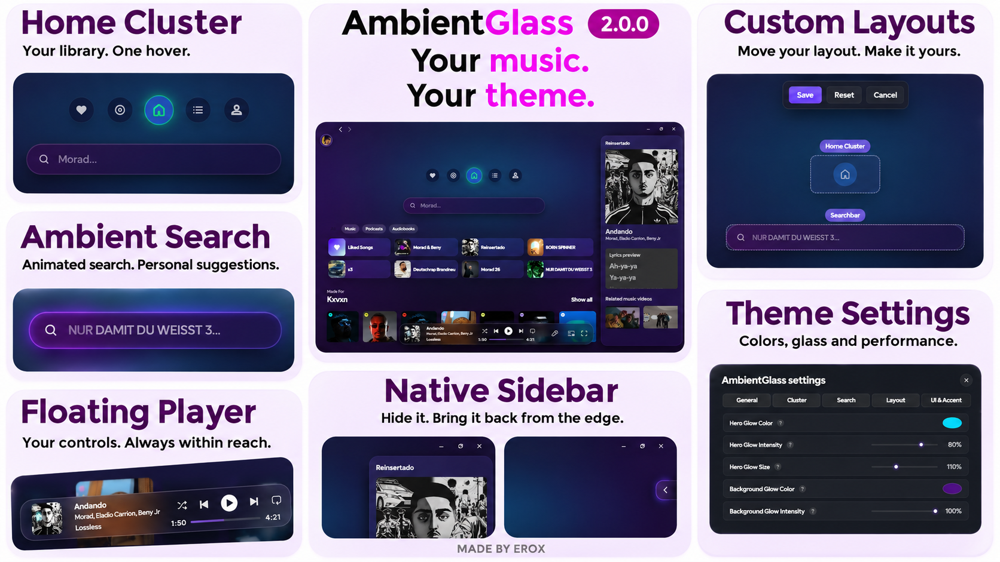

# AmbientGlass 2.0.0

A dark glass theme for Spotify, with a floating player, ambient search and a home cluster that expands on hover.



## What's in 2.0.0

The familiar appearance stays. This release focuses on the theme runtime, responsive layout, native sidebar behavior, menus, Jam and Marketplace compatibility.

- Hover Home for Liked Songs, Albums, Playlists and Artists.
- Use the floating search bar or Ctrl+K.
- Hover your profile picture to reveal Settings and installed addon shortcuts.
- Customize colors, glass, player dimensions, background effects and layout.
- Collapse the right sidebar completely; move to the right edge and click the revealed arrow to bring it back.
- Keep the Jam indicator above the player, without the native Jam strip underneath.
- Use transparent window controls on compatible Windows desktop clients.
- Enable Performance Mode when you want fewer expensive visual effects.

Full release changes: [English](CHANGELOG.md) · [Deutsch](CHANGELOG.de.md).
The bundled defaults are documented in [DEFAULTS.md](DEFAULTS.md).

## First launch and preferences

Every user sees the 2.0.0 introduction once, including users who completed an earlier introduction. Finishing, skipping or closing it records completion for this introduction revision. Open **Settings → Introduction → Show** to replay it.

New installations and **Reset to defaults** use the author's 2.0.0 preset. Existing personal settings and saved layouts are retained. Reset Settings and Reset Saved Layout separately if you want the complete new preset.

Theme preferences are local to the Spotify client. The exported preset contains appearance settings and layout only, without account identifiers, library lists, tokens or listening history.

## Requirements

Install and configure [Spicetify](https://spicetify.app/docs/getting-started/) for the desktop Spotify app first. Spotify updates can change its internal UI and APIs.

Development checks used Spotify **1.3.8.620** and Spicetify **2.46.4** on Windows. Spicetify's own [2.46.4 compatibility list](https://github.com/spicetify/cli/releases/tag/v2.46.4) lists Windows support through 1.3.7; the local checks do not extend that upstream support guarantee. Other operating systems were not validated. Custom transparent caption controls use Windows-only native services and fall back to Spotify's controls when unavailable.

## Marketplace

Open Spicetify Marketplace, choose Themes, search for AmbientGlass and install it. Marketplace reads the root manifest and loads the included runtime automatically; no batch script is required. Do not additionally enable a second runtime through the Extensions directory.

For the maintainer: the theme.js include is served through GitHub Pages. Follow PUBLISH.md to enable the included deployment before announcing this update.

## Install on Windows

1. Download the complete repository ZIP, or clone the repository.
2. Extract it.
3. Run **install.bat** from the extracted folder.

The installer uses the files beside it, finds your Spicetify configuration, backs up the previous theme/configuration and applies the theme. It does not download and execute a remote PowerShell installer.

For PowerShell, the equivalent is:

```powershell
powershell.exe -NoProfile -ExecutionPolicy Bypass -File .\install.ps1
```

The execution-policy flag applies only to that PowerShell process.

The runtime belongs in **Themes/AmbientGlass/theme.js** and loads through **inject_theme_js**. Do not also enable the same runtime as an extension. The installer disables a legacy Extensions/theme.js entry only when that file identifies itself as AmbientGlass; it retains the file and unrelated extensions.

## Install manually

Copy **theme.js**, **user.css**, **color.ini** and **manifest.json** into the **AmbientGlass** subfolder of your Spicetify **Themes** directory. Find your configuration location with `spicetify -c`.

Run:

```text
spicetify config current_theme AmbientGlass color_scheme Base
spicetify config inject_css 1 replace_colors 1 inject_theme_js 1
spicetify apply
```

If an older AmbientGlass installation enabled an additional extension named theme.js, remove that AmbientGlass extension entry first:

```text
spicetify config extensions theme.js-
```

Do not remove an unrelated extension that happens to have the same filename.

## Update and uninstall

- **update.bat** downloads and validates the four theme files from this repository's **main** branch, then applies them. Publish 2.0.0 before using it to obtain this release.
- **uninstall.bat** deactivates AmbientGlass and removes the four managed theme files. It keeps local preferences, backups and unrelated files. If another theme is active, that selection is retained.
- Backups are stored under your Spicetify configuration directory in **Backups/AmbientGlass/**.
- Inspect an operation without applying it with `powershell.exe -NoProfile -ExecutionPolicy Bypass -File .\install.ps1 -WhatIf`.

To install the exact contents of a tagged release, download that tag and run **install.bat**, rather than update.bat.

## Publishing

See [PUBLISH.md](PUBLISH.md) for the 2.0.0 upload and tag checklist, and [VALIDATION.md](VALIDATION.md) for the checks and their limits.

## Credits and license

Created by **EROX**. [MIT license](LICENSE).
